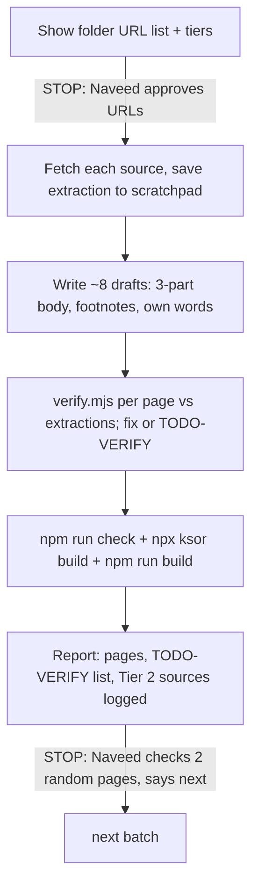

# Feature 02 — SOC corpus: plan (Wave 1 detailed)

- Status: Draft — awaiting owner approval
- Spec: `specs/02-soc-corpus/spec.md` · Branch: `feat/02-soc-corpus-wave-1`

## Architecture

Only `knowledge/` changes (plus `specs/02-soc-corpus/sources.md` and
`progress.md`). No code. Every page is a CommonMark file; folder `index.md`
files and `build.lock.json` are regenerated by `ksor build`.

```
knowledge/
  orientation/   overview (stable) · how-to-use · glossary
  rules-map/     invariants · escalation-policy · severity-model · data-handling
  windows-events/ event-4624 … event-7045 (10)  + .flashcards.yaml + .quiz.yaml
  wazuh/         architecture · alert-json-anatomy · rule-levels · windows-rules-reference
  mitre/         t1110-… (8)
  playbooks/     5 procedures + .flashcards.yaml + .quiz.yaml
  enrichment/    ip-reputation-policy · private-ip-ranges
  triage-note/   note-template · writing-rules · 3 examples
```

`order:` scheme — folder number × 100 + position, so a folder sorts by its
lowest document and Wave 2/3 pages slot in without renumbering:
orientation 1–3 (overview 1 is already stable), rules-map 200+, windows-events
300+, sysmon 400+ (W2), linux-auth 500+ (W2), wazuh 600+, mitre 700+,
playbooks 800+, enrichment 900+, triage-note 1000+, false-positives 1100+
(W2), sla 1200+ (W2), soc-fundamentals 1300+ (W3). Events are ordered by
Event ID within 300+ (e.g. 1102 → 301 … 7045 → 3xx), set in each batch.

## Flow per batch



## Batches (Wave 1)

| Batch | Pages | Sources (tier) | Interview needed |
|---|---|---|---|
| B1 | orientation/glossary, orientation/how-to-use, wazuh/architecture, wazuh/alert-json-anatomy, wazuh/rule-levels, windows-events/event-4624, 4625, 4648 | NIST CSRC glossary, SP 800-61r3, MITRE (T1); Wazuh docs (T1); Microsoft Learn event pages + Audit Logon (T1) | no |
| B2 | windows-events/event-4672, 4688, 4720, 4732, 4740, 1102, 7045, wazuh/windows-rules-reference | Microsoft Learn (T1); Wazuh ruleset at pinned tag (T1); 7045 per spec risk | no |
| B3 | mitre/ t1110, t1110-001, t1110-003, t1078, t1059-001, t1136-001, t1098, t1070-001 | attack.mitre.org (T1); SigmaHQ / MITRE CAR / Red Canary for detection hints (T2) | no |
| I1 | Interview session: rules-map, escalation triggers, severity, data handling, AbuseIPDB bands, triage-note template, playbook steps | human:naveed interview | **yes** |
| B4 | rules-map/ invariants, escalation-policy, severity-model, data-handling; enrichment/ ip-reputation-policy, private-ip-ranges; triage-note/ note-template, writing-rules | interview + Wazuh rules-classification, SP 800-61r3, CISA playbooks, AbuseIPDB docs, RFC 1918 (T1) | uses I1 |
| B5 | playbooks/ brute-force, success-after-failures, new-local-account, added-to-admin-group, audit-log-cleared; triage-note/ example-true-positive, example-false-positive, example-needs-info | earlier pages + SP 800-61r3, CISA, MITRE, Microsoft, Wazuh PoC (T1); SANS/Sigma (T2); interview | uses I1 |
| L | Link pass: add every cited cross-link event ↔ MITRE ↔ playbook ↔ Wazuh rule now that all targets exist | — | no |
| S | Study: 15 flashcard decks + 15 quizzes (10 events, 5 playbooks) | the documents themselves | no |
| A | Approval: Naveed reads pages (site), says "approved" per page or per batch; I record stamps | — | Naveed |

## Verification tooling (all free)

```sh
node .agents/skills/add-sources/verify.mjs <scratchpad>/<source>.txt knowledge/<path>.md
npm run check
npx ksor build
npm run build          # also runs the quiz audit for .quiz.yaml
grep -rn "TODO-VERIFY" knowledge     # the open list shown after each batch
```

Source extractions are saved under the session scratchpad
(`/tmp/claude-1000/…/scratchpad/sources/`), never in `knowledge/`.

## Commit pattern

One commit per batch (`Wave 1 B<n>: <pages>`), one for the regenerated lock,
one for `sources.md`/`progress.md`. Approval commits separate
(`Approve <pages>`). Push + PR only after Naveed's OK (plan step 15).
