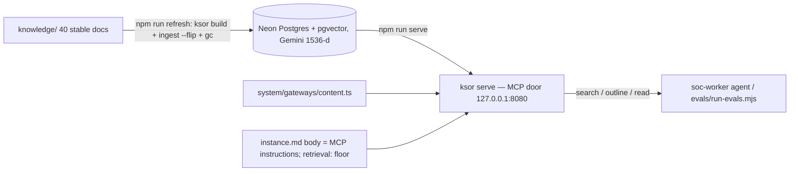

# Feature 05 — Agent surface: plan

## Architecture



## Files to touch

| File | Change |
|---|---|
| `system/gateways/content.ts` | server name `soc-handbook`; `search` description = scope + boundary + `FLOOR.search`; `k` default 5; keep `outline`, `read`, `min_trust_tier` |
| `instance.md` | add the `retrieval:` block exactly as `ksor calibrate` prints it |
| `evals/*` | already written (40 in-scope, 20 out-of-scope, runner, README) |
| `progress.md`, `LEARNING.md`, `specs/05-agent-surface/*` | status |

## Commands (verified with `--help` in session 1)

```sh
npm run check && npm run build                      # free
npm run provision                                   # HAAN — ksor schema --apply + ksor grant
npm run refresh                                     # HAAN — ksor build + ingest --flip + gc
npm run serve                                       # HAAN — 127.0.0.1:8080, KSOR_AUTH=disabled-local
curl -s http://127.0.0.1:8080/health                # free once serving
npx ksor calibrate --instance instance.md --queries-file evals/calibrate-in.txt --ooc-file evals/wave1-out-of-scope.txt   # HAAN
node evals/run-evals.mjs                            # free (local server); embeds each query via the door — HAAN as part of serve
```

## Preconditions (Naveed)

`.env` holds `KSOR_DB_URL` (Neon, pgvector enabled), `GEMINI_API_KEY` (free tier),
`KSOR_AUTH=disabled-local`. I only check that the variable names are present with
`grep -c '^KSOR_DB_URL=.' .env`-style tests — never printing values. Checked
2026-11-10: all three are present and non-empty (counts only; no value read out).

## Verify

- Boot report: tools listed, floor present, no gateway refusal.
- `/health`: generation active, `abstain_gate` on, `embedding_space` ok.
- `run-evals.mjs` report against the targets in the spec.
